# Campus Waste Sorting with Vision Transformers — Final Report

Congxian Zhou, Minahil Chaudhry, Wenyan Zhu, Deborah Sonoiki · EECS 442 · 2026-11-16

> Canonical, editable version (with interactive charts): https://claude.ai/artifact/8HjAba1VnSQBTZdG66xnuq (export to PDF/Word from the doc). This file is a plain-Markdown copy with the figures from `results/figures/`.

## Abstract

We ask whether a waste classifier trained on public photos can sort everyday items into the three U-M campus bins (recycling, compost, landfill) and still work on photos from a different source. We relabel 660 reviewed RealWaste images with U-M Where to Throw rules (on campus, glass and plastic film go to landfill), split them 461/99/100 with near-duplicates kept together, and build a 142-image proxy test set of web photos with different backgrounds in place of the planned campus photos. On a pretrained DeiT-Tiny we compare a linear probe with fine-tuning of the last transformer block, with and without brightness-rotation augmentation, on 25% and 100% of the training data, over three seeds. The best model (last-block fine-tuning, augmentation, all data) reaches 0.80 accuracy and 0.80 macro-F1 on the RealWaste test split and 0.77 accuracy and 0.78 macro-F1 on the proxy set, at 15 ms per image on a CPU. Fine-tuning, augmentation and more data each help the new-photo set more than the original one (+0.03, +0.02 and +0.05 macro-F1 versus +0.01, +0.02 and +0.02). The remaining errors concentrate on items whose campus bin contradicts their material (plastic bags and film, glass bottles), which the model confidently calls recyclable. Beyond the proposal, a DINOv2-S backbone adapted the same way reaches 0.88 and 0.87, CLIP ViT-L/14 used zero-shot as an item recogniser behind the campus rule table reaches 0.87 and 0.95 without any waste training, and abstaining on the least confident 20% of photos lifts accuracy on the answered photos to between 0.88 and 0.95; background-swap augmentation and 19 targeted film annotations did not help. A Gradio demo returns the item type, the bin and calibrated class scores for an uploaded photo, and abstains with a hint when unsure.

## 1. Introduction

Campus waste is easy to mis-sort. A coffee cup, a plastic clamshell, and a paper towel each belong in a different bin under University of Michigan rules, and the material alone does not decide the bin. This project builds a photo-based classifier that assigns a single-item photo to one of three U-M disposal bins: recycling, compost, or landfill.

The main question is whether a model trained on public waste images works on new photos with different backgrounds and lighting. We train on RealWaste [3], a public dataset photographed at a landfill reception area, and relabel its material classes into bins using U-M Where to Throw guidance [4]. We evaluate on a held-out RealWaste test split and on a second test set drawn from a different image source (Section 3).

The classifier is a pretrained DeiT-Tiny [2], a compact Vision Transformer [1]. We compare a frozen encoder with a linear classifier against a model that also fine-tunes the final transformer block. Each is trained with and without brightness and rotation augmentation, and with 25% and 100% of the training data. The main comparison is repeated over three random seeds and reported with accuracy, macro-F1, per-class recall, confusion matrices, and runtime.

## 2. Method

The classifier is DeiT-Tiny [2], a Vision Transformer [1] with 12 blocks, embedding width 192, 3 attention heads and 5.7M parameters, pretrained on ImageNet-1k (timm weights `deit_tiny_patch16_224.fb_in1k`, no distillation token). A 224x224 image is cut into 196 patches of 16x16 pixels. Each patch is linearly embedded, a position embedding is added, and a learnable class token is prepended. Self-attention mixes information across patches in every block, and a linear head on the final class token predicts the bin.

We compare two ways of adapting the pretrained encoder to three U-M bins:

- **Linear probe (baseline):** the encoder is frozen and only the 3-way linear head is trained (579 parameters).
- **Last-block fine-tuning:** the head plus the final transformer block and the final LayerNorm are trained (445,827 parameters, 7.8% of the model). All earlier blocks stay frozen.

Each variant is trained with and without augmentation. The augmentation is brightness jitter (scale factor drawn from [0.6, 1.4]) followed by a random rotation of up to 45 degrees, applied to the 256-pixel training image before the 224-pixel center crop. The no-augmentation baseline uses only the deterministic resize-to-256 / center-crop-224 pipeline, which is also the evaluation pipeline for every model.

All runs use AdamW (weight decay 0.05), cosine learning-rate decay, batch size 32, cross-entropy loss and 40 epochs. The head and block learning rates are chosen on the validation split (Section 4). The checkpoint with the best validation macro-F1 is evaluated on both test sets. The 25% data condition uses a stratified random quarter of the training split, drawn separately for each seed.

## 3. Dataset and Labeling

The benchmark is 660 reviewed RealWaste images relabeled into U-M bins, plus a 142-image proxy for the planned campus photos. RealWaste [3] has 4,752 photos (524x524) of single items at the Whyte's Gully landfill reception in Wollongong, Australia, with nine material labels (CC BY-NC-SA 4.0). We drew 725 candidates stratified over the nine materials, oversampling plastic because that folder mixes rigid containers with film, mapped each material to a bin with the U-M rules below, and then visually reviewed every candidate on labelled contact sheets (`data/review_sheets/`).

**U-M rules used.** The Where to Throw tool itself is a video, so item rules were taken from OCSI pages: compost takes food scraps including meat, coffee grounds and filters, napkins, paper towels and BPI-certified compostable ware [5]; campus recycling no longer accepts glass [6]; rigid plastics #1-2 and #4-7 (bottles, tubs, cups, containers) are recycled but plastic film is not [7]; snack bags and sauce packets are landfill [8]; juice and milk cartons are accepted by U-M's single-stream processor WWRA [9]; batteries and e-waste go to EHS Hazmat, not a bin [6].

| RealWaste material | U-M bin | Rule | Kept images |
| --- | --- | --- | --- |
| Cardboard | recycling | paper/cardboard, cartons accepted | 59 |
| Paper | recycling | clean paper | 56 |
| Metal | recycling | cans and tins; used foil and aerosols excluded | 30 |
| Plastic (rigid) | recycling | #1-2, #4-7 bottles, tubs, cups, containers | 59 |
| Plastic (film, bags, foam) | landfill | film not accepted; relabeled at review | 21 |
| Glass | landfill | glass not accepted in campus recycling | 75 |
| Miscellaneous Trash | landfill | default for mixed and non-recyclable items | 65 |
| Textile Trash | landfill | no textile bin on campus | 69 |
| Food Organics | compost | food scraps including meat and bones | 114 |
| Vegetation | compost | plant material | 112 |

**Review outcome.** 639 candidates kept with the mapped bin, 21 relabeled (all plastic film, bags or foam moved to landfill) and 65 excluded. Exclusions were used aluminium foil (campus rule unverified and soiling not judgeable), aerosol and insecticide cans, e-waste and hazardous items (string lights, lamp, nail polish, needles), construction debris, tiny fragments, composite items (Pringles can, hardcover notebooks), items needing information not in the photo (a thermal receipt, a wooden fork of unknown certification, produce wrapped in film), and piles of soil. The final set is 204 recycling, 226 compost and 230 landfill images. One reviewer made all decisions, with the rule-based mapping as the first opinion and the visual pass as the second; the proposal's two-person protocol was not possible here. Decisions are in `data/reviewed/realwaste_review.csv` and `review_notes_realwaste.md`.

**Near-duplicates and splits.** The same object is often photographed twice in a row (banana peels, pastry twists, scrap piles). Two candidates were linked if their DeiT-Tiny feature cosine similarity was at least 0.85, or at least 0.70 for same-material neighbours within three file indices. This gave 669 groups (28 pairs, 9 triples, one cluster of 11 grass-clipping piles). Groups were assigned whole to a stratified 70/15/15 split: 461 train, 99 validation and 100 test images, with groups of four or more sent to train.

**Second test set (proxy for campus photos).** No campus photos were available for this run, so the second test set is drawn from a different public source: the 12-class garbage classification set of web photos with varied backgrounds and lighting [10]. We sampled 194 candidates over 11 classes (battery excluded as hazardous), mapped them to bins (biological to compost; cardboard, paper, plastic, metal to recycling; glass, trash, clothes, shoes to landfill) and applied the same review. 142 images were kept: 41 recycling, 43 compost, 58 landfill, with 4 relabeled (three plastic bags and wrappers to landfill, one apple core to compost) and 52 excluded (produce still growing, market piles, product sets, 3D renders, hands in frame). These are cleaner, more product-like photos than a phone snapshot on campus, so the gap we measure is a lower bound on the real campus shift.

## 4. Experimental Setup

The main experiment is a 2 x 2 x 2 grid repeated with three seeds (24 runs): model (linear probe vs. last-block fine-tuning) x augmentation (none vs. brightness + rotation) x training data (25% vs. 100% of the 461 training images). Every run is selected on the 99-image validation split and evaluated once on the 100-image RealWaste test split and the 142-image proxy set.

**Learning rates** were chosen on the validation split with seed 0, 100% data and no augmentation (40 epochs each). For the linear probe, head learning rates 1e-3, 3e-3 and 1e-2 gave validation macro-F1 0.887, 0.898 and 0.899, so 1e-2 was used. For last-block fine-tuning (head 1e-3), block learning rates 5e-5, 1e-4 and 3e-4 all gave 0.889; the middle value 1e-4 was used. Best validation epochs were early (5 to 9 of 40), so the checkpoint with the best validation macro-F1 is used throughout.

**Seeds** control head initialisation, data order, augmentation draws and the 25% subset. **Metrics** are accuracy, macro-F1, per-class recall and confusion matrices on each test set, plus runtime: training wall-clock, GPU batched inference and single-image CPU latency (the demo setting). Results are reported as mean ± standard deviation over seeds, and factor effects as paired differences between runs that differ in exactly one factor.

**Hardware.** All runs used one NVIDIA GeForce RTX 4090 with PyTorch 2.6 and timm 1.0. Images are preloaded at 256 pixels, so a 40-epoch run takes about 15 s without augmentation; the whole grid runs in about 10 minutes.

## 5. Results

Last-block fine-tuning with brightness-rotation augmentation on all 461 training images is the best configuration on both test sets: accuracy 0.80 ± 0.01 on the RealWaste test split and 0.77 ± 0.03 on the proxy new-photo set (macro-F1 0.80 and 0.78). The other seven configurations sit within 2 to 5 points of it on RealWaste but up to 13 points lower on the proxy set, so the design choices matter far more for new photos than for the original source.

| Configuration | Train images | RealWaste test acc | RealWaste test macro-F1 | Proxy test acc | Proxy test macro-F1 | Best epoch | Train time (s) |
| --- | --- | --- | --- | --- | --- | --- | --- |
| Linear probe, no aug, 25% | 115 | 0.753 ± 0.006 | 0.745 ± 0.011 | 0.671 ± 0.032 | 0.675 ± 0.032 | 3 | 7 |
| Linear probe, no aug, 100% | 461 | 0.760 ± 0.017 | 0.758 ± 0.020 | 0.716 ± 0.018 | 0.725 ± 0.017 | 5 | 15 |
| Linear probe, aug, 25% | 115 | 0.767 ± 0.015 | 0.762 ± 0.014 | 0.683 ± 0.042 | 0.691 ± 0.042 | 11 | 19 |
| Linear probe, aug, 100% | 461 | 0.777 ± 0.006 | 0.777 ± 0.007 | 0.685 ± 0.029 | 0.695 ± 0.029 | 5 | 68 |
| Last-block FT, no aug, 25% | 115 | 0.750 ± 0.026 | 0.745 ± 0.029 | 0.643 ± 0.033 | 0.644 ± 0.028 | 5 | 7 |
| Last-block FT, no aug, 100% | 461 | 0.770 ± 0.010 | 0.767 ± 0.014 | 0.744 ± 0.016 | 0.754 ± 0.015 | 7 | 16 |
| Last-block FT, aug, 25% | 115 | 0.777 ± 0.031 | 0.771 ± 0.035 | 0.728 ± 0.025 | 0.735 ± 0.021 | 13 | 20 |
| **Last-block FT, aug, 100%** | 461 | **0.803 ± 0.012** | **0.801 ± 0.011** | **0.768 ± 0.028** | **0.775 ± 0.028** | 15 | 73 |

Mean ± sd over seeds 0 to 2; train time is one 40-epoch run on the RTX 4090 (augmented runs are slower because rotation is applied per image on the CPU).

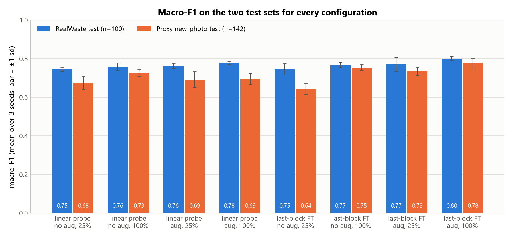

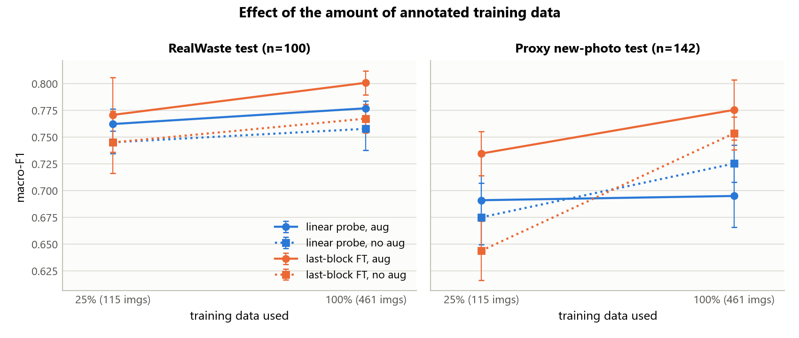

| Factor (paired, 12 pairs) | Δ RealWaste macro-F1 | Δ proxy macro-F1 | pairs improved (RealWaste / proxy) |
| --- | --- | --- | --- |
| Last-block FT vs linear probe | +0.010 ± 0.017 | +0.030 ± 0.046 | 67% / 67% |
| Augmentation vs none | +0.024 ± 0.015 | +0.025 ± 0.048 | 92% / 75% |
| 100% vs 25% training data | +0.020 ± 0.023 | +0.051 ± 0.059 | 92% / 75% |

**Factor effects.** Fine-tuning the last block adds +0.01 macro-F1 on RealWaste but +0.03 on the proxy set; augmentation adds about +0.02 on both; using all the data instead of a quarter adds +0.02 on RealWaste and +0.05 on the proxy. The strongest interaction is between fine-tuning and augmentation at 25% data: without augmentation, fine-tuning 0.45M parameters on 115 images gives the worst proxy score of the grid (0.64), and with augmentation it recovers to 0.74.

**Per-class behaviour (main model).** Compost is easiest (recall 0.92 on RealWaste, 0.86 on the proxy), recycling is 0.78 on both, and landfill is hardest at 0.70 and 0.69. Confusions are almost all between recycling and landfill: 41 of the 59 RealWaste test errors (three seeds pooled) and 73 of the 99 proxy errors. Compost is confused with landfill (18 and 25 errors) and with recycling only once.

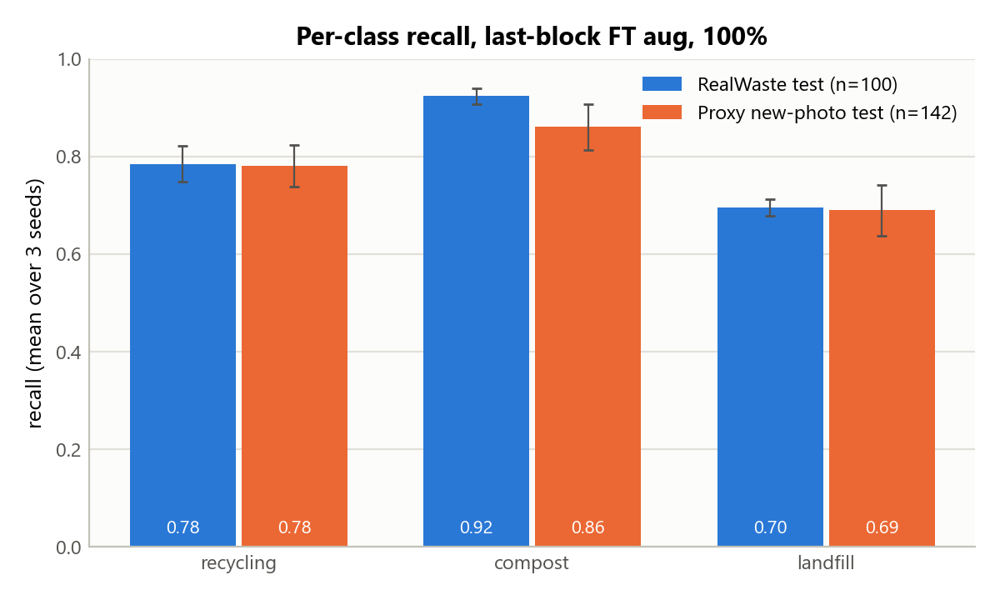

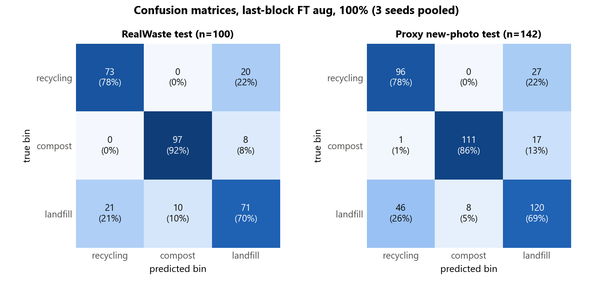

**Robustness to synthetic shifts.** Re-evaluating the 100%-data models on the RealWaste test images with brightness scaled by 0.5 or 1.5 and with rotations of ±30°, 90° and 180° changes macro-F1 by at most 4 points; the augmented fine-tuned model loses at most 2.4 points (at +30°). Lighting and orientation are therefore not what separates the two test sets; object type and background are (`results/shift_eval_summary.csv`).

**Runtime.** Inference costs 0.16 ms per image batched on the GPU and 15 ms per single image on a 14-thread CPU, so the demo runs without a GPU. Training takes 15 s per 40-epoch run without augmentation and about 70 s with it.

**A note on validation.** Validation macro-F1 at the selected checkpoint ranged from 0.875 to 0.895 across the 100%-data configurations and did not separate them; the configuration with the highest validation score (linear probe, no augmentation, 0.895) had the lowest RealWaste test score (0.758). The main model was therefore chosen after seeing both test sets, and the table above is the full comparison. The validation split also scores about 10 points above the test split, partly because the best of 40 epochs is an optimistic estimate and partly by chance in a 99-image split.

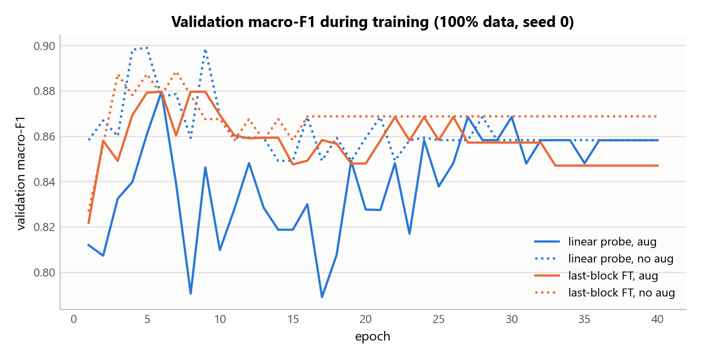

## 6. Analysis

The mistakes concentrate on items whose U-M bin contradicts the usual material prior: plastic film and glass, which the campus rules send to landfill although they look recyclable.

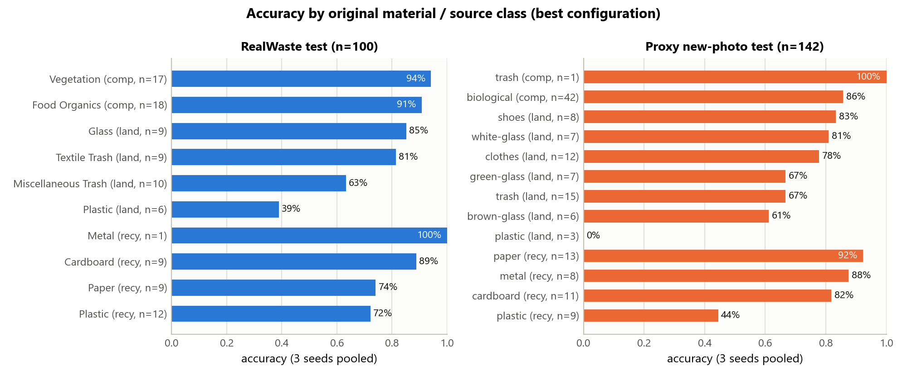

**Campus-rule items.** Plastic film, bags and wrappers (landfill by rule) are sorted correctly in 39% of RealWaste test cases and in none of the three proxy cases; the two plastic grocery bags in the proxy set are called recycling with 0.95 and 0.99 confidence. Glass reaches 85% on RealWaste, where most glass images are shards and bottle bottoms on the landfill floor, but only 61% to 81% on the proxy set, whose brown and green bottles and clear jars look like clean recyclables. Rigid plastic shows the reverse confusion on the proxy set (44%): clean product-shot bottles are pushed toward landfill. Only 21 film images (3% of the training data) carry the film rule, and glass is learned partly as a RealWaste texture rather than as a material.

**Error examples.** The highest-confidence RealWaste errors are sachets, wrappers and bags called recycling, crumpled or printed paper called landfill, a dried leaf and a red fruit called landfill, and hair and lint called compost. On the proxy set they are plastic bags, an Oreo wrapper and chip bags called recycling, brown and green bottles called recycling, and a diaper and a pair of shorts called recycling.

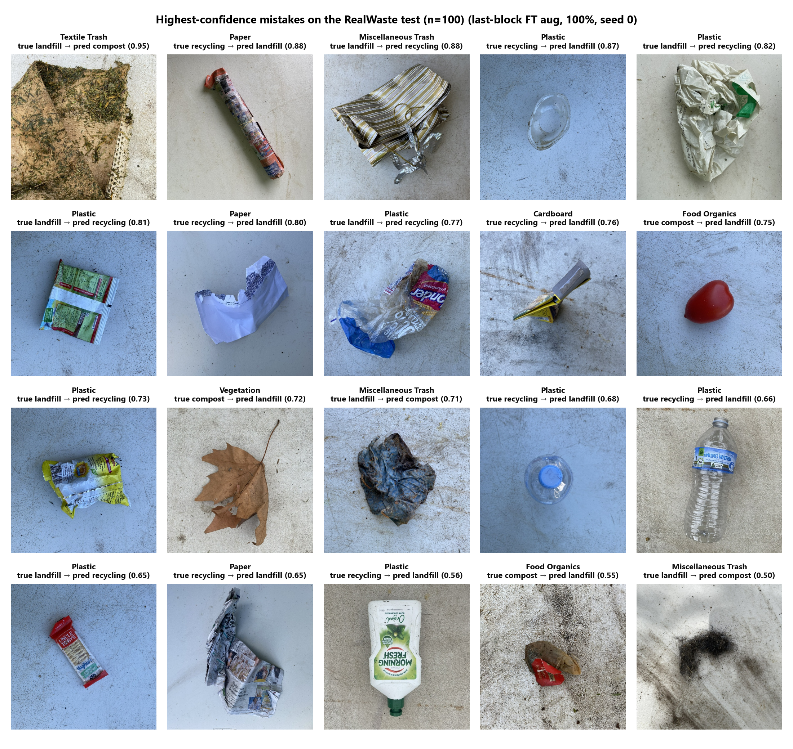

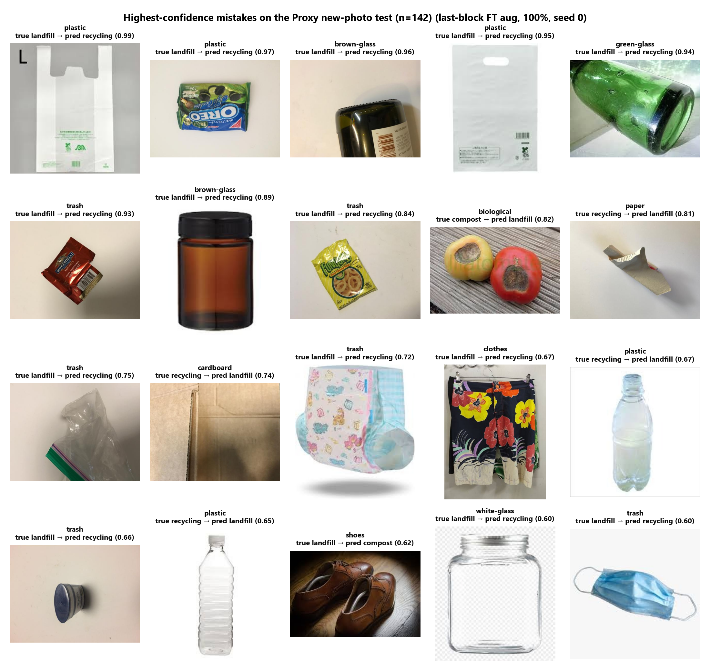

**What the model looks at.** Attention rollout [12] from the class token concentrates on the object for confident correct predictions (a stack of documents, a plant root, a sock, an avocado, boots). For the confident mistakes it also sits on the object, not on the background: the grocery bag, the Oreo wrapper, the neck of the bottle. The errors are therefore about what the rule says for a recognised object, not about failing to find it, which is consistent with the synthetic-shift result that lighting and orientation barely matter.

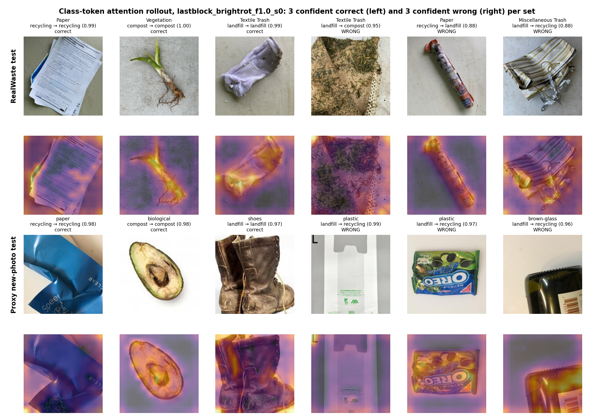

**In-distribution versus new photos.** The gap between the RealWaste test split and the proxy set is 2.6 macro-F1 points for the main model (0.801 to 0.775), 1.3 for last-block fine-tuning without augmentation, 3.3 for the plain linear probe, and 8.2 for the augmented linear probe. Fine-tuning the last block shrinks the gap because the features themselves adapt; augmenting a frozen encoder only regularises the head, and its proxy score is about one standard deviation below the un-augmented probe, so that difference should be read as noise. More data helps the proxy set twice as much as the in-distribution test (+0.05 versus +0.02), and without augmentation fine-tuning on only 115 images overfits the RealWaste look (0.64 proxy macro-F1, the worst run family).

**Compost errors.** The compost-to-landfill errors are dark or rotten food and dirty items; the landfill-to-compost errors are fibrous items such as hair, lint and a grass-covered cloth. Both are texture confusions that more varied compost examples (plates of leftovers, napkins, coffee cups with grounds) would address.

## 7. Demo

The demo takes one uploaded photo and returns the item type, the predicted bin, the calibrated class scores and the matching U-M rule text; when the calibrated confidence is below the threshold that keeps 80% coverage on the validation split, it abstains and names the two bins in doubt and what to check on the item. Three engines share the same interface:

- `twostage` (default): DeiT-Tiny 10-way item head + campus rule table (Section 8.1), so the answer shows the recognised item and the rule it triggered.
- `direct`: the main 3-way DeiT-Tiny model of Section 5.
- `clip`: CLIP zero-shot item prompts + rule table (Section 8.3); `--clip_model ViT-L-14` selects the most accurate variant.
- `src/demo.py` launches the local Gradio page at http://127.0.0.1:7860; `src/predict.py --image photo.jpg --out pred.png` gives the same answer on the command line and saves a figure with the photo beside its score bars.

Only the trained head and last block are stored per run (about 1.8 MB for DeiT-Tiny); the demo rebuilds the backbone from public weights and loads those parameters on top. Temperature scaling and the abstention threshold are fitted on the validation split when an engine loads. Single-image CPU latency is 15 ms for DeiT-Tiny and about 35 ms for the larger backbones, so the demo runs on a laptop without a GPU.

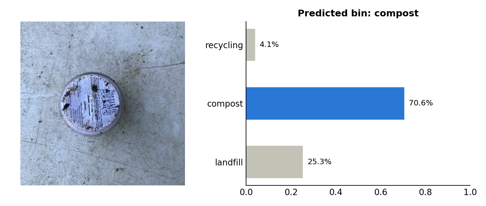

## 8. Extensions beyond the proposal

Three changes outside the proposal's frame move accuracy far more than any factor inside it. A stronger pretrained backbone (DINOv2-S, last block fine-tuned the same way) reaches 0.88 on RealWaste and 0.87 on the proxy set; an open-vocabulary model used as an item recogniser behind the campus rule table (CLIP ViT-L/14, zero-shot, no waste training at all) reaches 0.87 and 0.95; and abstaining on the least confident 20% of photos lifts the accuracy of the answered photos to between 0.88 and 0.95. Two other ideas did not help: background-swap augmentation and a batch of 19 targeted plastic-film annotations. Full tables: `results/extensions_summary.md`.

**8.1 Item classifier + rule table.** A 10-way item head (nine RealWaste materials with plastic split into rigid and film) mapped to bins through the campus rule table gives the same in-distribution accuracy (0.803 ± 0.015) and a small, not significant gain on the proxy set (0.786 ± 0.022, +1.8 points, 95% CI −1.9 to +5.9). The bin decision becomes auditable, the rule table can change without retraining, and confidence ranks errors better (accuracy on the 80% most confident RealWaste photos 0.91 vs 0.88). Item accuracy: 0.72 RealWaste, 0.64 proxy.

**8.2 Backbone study** (same recipe, brightness-rotation augmentation, 100% data, 3 seeds):

| Backbone | Adaptation | Trainable params | RealWaste acc | RealWaste F1 | Proxy acc | Proxy F1 | CPU ms/img |
| --- | --- | --- | --- | --- | --- | --- | --- |
| DeiT-Tiny (5.7M) | linear probe | 579 | 0.777 ± 0.006 | 0.777 ± 0.007 | 0.685 ± 0.029 | 0.695 ± 0.029 | 15 |
| DeiT-Tiny (5.7M) | last-block FT | 445,827 | 0.803 ± 0.012 | 0.801 ± 0.011 | 0.768 ± 0.028 | 0.775 ± 0.028 | 16 |
| DeiT-Small (22M) | linear probe | 1,155 | 0.860 ± 0.017 | 0.857 ± 0.017 | 0.786 ± 0.029 | 0.790 ± 0.027 | 29 |
| DeiT-Small (22M) | last-block FT | 1,776,387 | 0.867 ± 0.021 | 0.865 ± 0.020 | 0.808 ± 0.027 | 0.811 ± 0.028 | 31 |
| DINOv2-S (22M) | linear probe | 1,155 | 0.847 ± 0.025 | 0.842 ± 0.027 | 0.765 ± 0.065 | 0.772 ± 0.065 | 36 |
| DINOv2-S (22M) | last-block FT | 1,777,155 | 0.883 ± 0.012 | 0.880 ± 0.013 | 0.866 ± 0.019 | 0.870 ± 0.017 | 37 |
| CLIP ViT-B/32 (88M) | linear probe | 2,307 | 0.850 ± 0.010 | 0.845 ± 0.011 | 0.854 ± 0.008 | 0.860 ± 0.007 | 30 |
| CLIP ViT-B/32 (88M) | last-block FT | 7,091,715 | 0.847 ± 0.012 | 0.844 ± 0.012 | 0.885 ± 0.018 | 0.889 ± 0.017 | 32 |

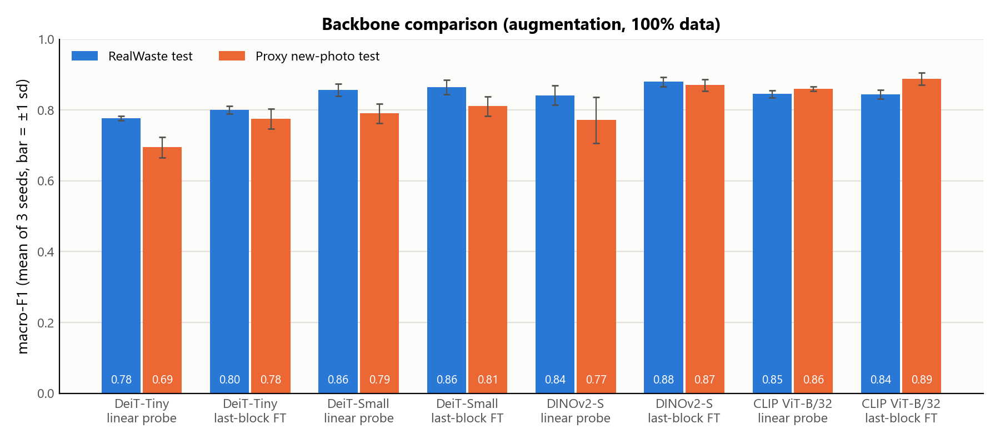

DINOv2-S fine-tuned adds +8.0 accuracy points on RealWaste (95% CI +3.3 to +13.3) and +9.9 on the proxy set (+3.3 to +16.2); CLIP ViT-B/32 fine-tuned is the best trained model on the proxy set (+11.7, CI +5.9 to +17.8). The cost is 2 to 2.5x the CPU latency.

**8.3 CLIP zero-shot with item prompts.** CLIP names the item (4 templates x 4 to 7 phrasings per class) and the rule table assigns the bin; direct bin prompts were tried as a control.

| CLIP model (OpenAI weights) | Prompt design | RealWaste acc / F1 | Proxy acc / F1 | Item accuracy (RW / proxy) |
| --- | --- | --- | --- | --- |
| ViT-B/32 | item prompts + rule table | 0.790 / 0.794 | 0.880 / 0.881 | 0.68 / 0.79 |
| ViT-B/16 | item prompts + rule table | 0.790 / 0.794 | 0.859 / 0.862 | 0.70 / 0.80 |
| ViT-L/14 | item prompts + rule table | 0.870 / 0.867 | 0.951 / 0.952 | 0.81 / 0.89 |
| ViT-B/32 | direct bin prompts | 0.540 / 0.453 | 0.585 / 0.542 | - |
| ViT-L/14 | direct bin prompts | 0.630 / 0.515 | 0.683 / 0.674 | - |

ViT-L/14 is +18.3 points over the main model on the proxy set (CI +11.7 to +24.9) and +8.5 over DINOv2-S fine-tuned (CI +3.1 to +14.1), with no significant difference on RealWaste. It sorts every plastic-film item and 89 to 90% of the glass correctly:

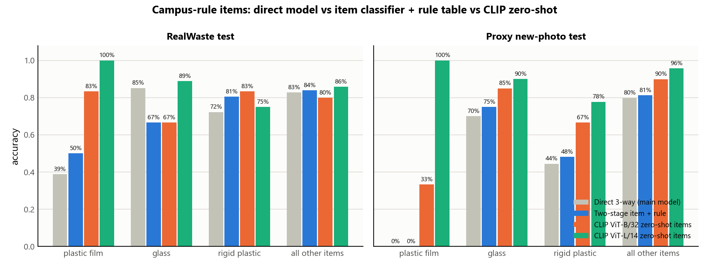

**8.4 Calibration and abstention.** Temperature scaling (T fitted on validation; 1.4 for the main model) lowers ECE from 0.087 to 0.061 (RealWaste) and 0.076 to 0.064 (proxy). Answering only the 80% most confident photos:

| Model | RealWaste: all / top 80% | Proxy: all / top 80% | ECE raw → calibrated (RW) |
| --- | --- | --- | --- |
| DeiT-Tiny direct (main model) | 0.803 / 0.875 | 0.768 / 0.833 | 0.087 → 0.061 |
| DeiT-Tiny two-stage | 0.803 / 0.908 | 0.786 / 0.836 | 0.091 → 0.088 |
| DINOv2-S last-block FT | 0.883 / 0.946 | 0.866 / 0.912 | 0.078 → 0.038 |
| CLIP ViT-B/32 last-block FT | 0.847 / 0.942 | 0.885 / 0.924 | 0.128 → 0.079 |

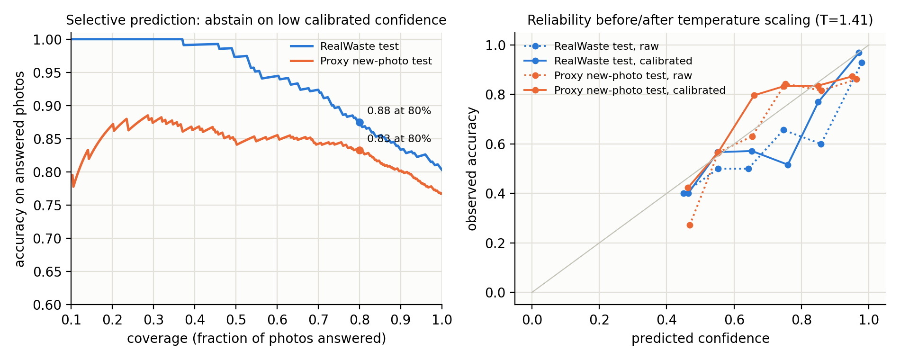

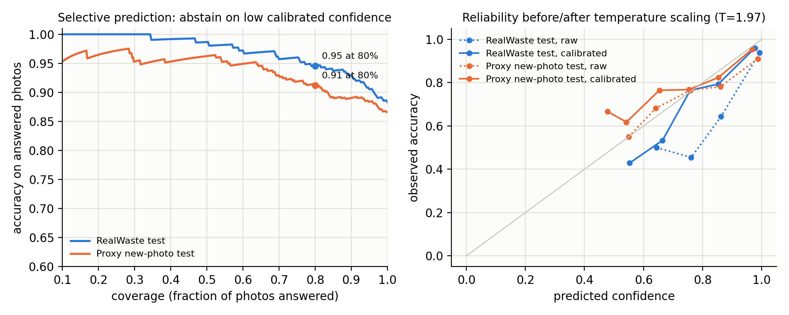

**8.5 Targeted vs random extra annotation.** 180 further plastic images were reviewed to mine film (19 found) and compared with 19 random extra images. Neither changed accuracy (RealWaste 0.780 ± 0.020 and 0.793 ± 0.031 vs 0.803; proxy 0.770 and 0.779 vs 0.768; all CIs include zero); film accuracy moved from 0.39 to 0.44 on six RealWaste film photos and stayed at 0 of 3 on the proxy. Nineteen images are too few to teach a 5.7M-parameter model a rule that contradicts its visual prior.

**8.6 Augmentation variants** (DeiT-Tiny last-block FT, 100% data, 3 seeds):

| Augmentation | RealWaste acc | Proxy acc | Train time (s) |
| --- | --- | --- | --- |
| none | 0.770 ± 0.010 | 0.744 ± 0.016 | 16 |
| brightness + rotation (proposal) | 0.803 ± 0.012 | 0.768 ± 0.028 | 73 |
| strong (crop, flip, colour, rotation) | 0.777 ± 0.006 | 0.770 ± 0.051 | 43 |
| strong + background swap (GrabCut masks, synthetic backgrounds) | 0.760 ± 0.017 | 0.768 ± 0.025 | 46 |

Neither variant beats the proposal's augmentation; synthetic backgrounds do not reproduce the real shift, which is in object appearance.

**8.7 Confidence intervals for the main grid** (bootstrap over test images, 2,000 resamples, seed-averaged). Significant: main model vs plain linear probe (+4.3 points RealWaste, CI +0.7 to +8.3; +5.2 proxy, CI +0.9 to +9.9); augmentation for the fine-tuned model on RealWaste (+3.3, CI +0.7 to +6.7) and at 25% data on the proxy (+8.5, CI +5.2 to +11.7); fine-tuning vs linear probe on the proxy (+8.2, CI +3.5 to +13.4). Intervals touching zero: 100% vs 25% data (+2.7 RealWaste, +4.0 proxy) and augmentation at 100% data on the proxy (+2.3). Full tables: `results/bootstrap.csv`, `results/bootstrap_ext.csv`.

## 9. Limitations and Future Work

- **No real campus photos.** The proposal's central question is answered with a proxy set of web photos. Those are cleaner and more product-like than a phone snapshot of an item over a campus bin, so the measured shift is not the campus shift. The pipeline already accepts a `campus_test` split; adding the planned 90 campus photos is the first thing to do.
- **Single reviewer and unverified rules.** One reviewer applied the rules; the proposal planned two independent reviewers. Several item rules could not be confirmed from U-M pages (aluminium foil, aerosol cans, thermal receipts, compostable cutlery) and those items were excluded, so the benchmark under-represents exactly the items people find confusing. Rules also change (glass left campus recycling), so labels need re-checking against the current Where to Throw tool.
- **Small evaluation sets.** With 100 and 142 test images, a 95% confidence interval on accuracy is roughly ±8 points (Section 8.7 gives bootstrap intervals): differences of a few points between configurations are ties, and the film and glass subgroups hold 3 to 20 images.
- **Source bias.** RealWaste photos share one landfill-floor background and Australian packaging, so the model partly learns that context. Items whose bin depends on invisible information (a compostability label, how dirty a container is) were excluded from the benchmark; the demo now abstains on low confidence but cannot see such labels either.
- **Zero-shot prompts were hand-written** by the author with knowledge of the ten item classes and tuned once; a fairer comparison would fix the prompts on the validation split, and the proxy set may be easier for CLIP because it resembles the web images CLIP was trained on. CLIP ViT-L/14 is also 70 times larger than DeiT-Tiny.
- **Scope.** Full fine-tuning, larger backbones than ViT-L/14, prompt tuning, and a campus-specific training set collected by the team remain open; the extra-annotation experiment used only 19 images per arm and should be repeated with a few hundred.

## 10. Conclusion

A compact Vision Transformer adapted on about 460 reviewed public images sorts single items into U-M bins with 0.80 accuracy in distribution and 0.77 on photos from another source. The transfer question has a two-part answer: changes in lighting and orientation cost at most a few points, but items whose campus bin contradicts their material prior (plastic film, glass) are where the model fails, and those failures are confident. Within the proposal's grid, fine-tuning the last block, augmenting, and using all the data each pay off more on new photos than on the original source, and augmentation is what makes fine-tuning safe with only 115 images. Beyond the grid, the decisive ingredient is item knowledge rather than campus data: a DINOv2-S backbone lifts both test sets by 8 to 10 points, and CLIP ViT-L/14 used zero-shot as an item recogniser behind the campus rule table reaches 0.95 on the new-photo set with no waste training, sorting every plastic-film item correctly. The practical recipe for a campus-ready classifier is therefore an item recogniser (zero-shot or a strong fine-tuned backbone), the campus rule table kept outside the model so it can change, calibrated confidence with abstention and a "what to check" hint, and a small set of campus photos to confirm the numbers.

## References

1. Dosovitskiy et al. An Image is Worth 16x16 Words: Transformers for Image Recognition at Scale. ICLR 2021. https://arxiv.org/abs/2010.11929
2. Touvron et al. Training data-efficient image transformers & distillation through attention. ICML 2021. https://arxiv.org/abs/2012.12877
3. Single, Iranmanesh, Raad. RealWaste. UCI Machine Learning Repository, 2023. https://archive.ics.uci.edu/dataset/908/realwaste ; paper: RealWaste: A Novel Real-Life Data Set for Landfill Waste Classification Using Deep Learning, Information 14(12):633, 2023.
4. University of Michigan OCSI. Where to Throw. https://ocsi.umich.edu/resources/where-to-throw/
5. University of Michigan OCSI. Composting. https://ocsi.umich.edu/programs/waste-reduction/composting/
6. University of Michigan OCSI. FAQ. https://ocsi.umich.edu/resources/faq/
7. University of Michigan OCSI. Plastics Recycling: What's the Truth? (Dec 2025). https://ocsi.umich.edu/wp-content/uploads/2025/12/Plastics-Recycling-Fact-Sheet.pdf
8. U-M Planet Blue Ambassadors. A Behind-the-Scenes Look at a Campus Waste Audit, Part 2. https://pba.umich.edu/a-behind-the-scenes-look-at-a-campus-waste-audit-part-2-the-findings/
9. Western Washtenaw Recycling Authority. What can and can't be recycled with the new single stream system. https://chelseaupdate.com/wwra-what-can-and-cant-be-recycled-with-the-new-single-stream-system/
10. Garbage classification image dataset (12 classes), Hugging Face mirror NeoAivara/Waste_Classification_data (Apache-2.0). https://huggingface.co/datasets/NeoAivara/Waste_Classification_data
11. Wightman. PyTorch Image Models (timm), 2019. https://github.com/huggingface/pytorch-image-models
12. Abnar and Zuidema. Quantifying Attention Flow in Transformers. ACL 2020. https://arxiv.org/abs/2005.00928
